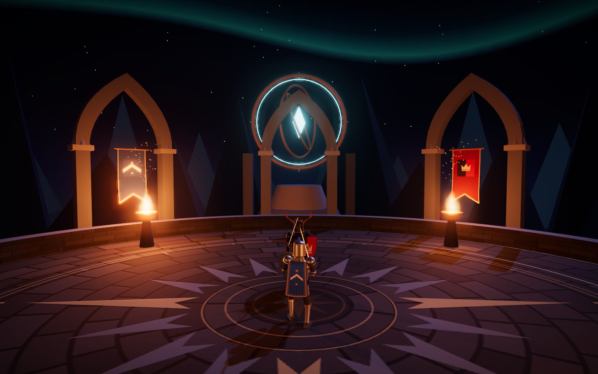

# Duel Knights

A torch-lit 3D sword duel in the browser. Pick a knight, a foe and a battleground. First to three rounds.
Everything (the knights, the arena, the sound) is built in code from primitives with
[Three.js](https://threejs.org/). The game loads no models, textures or audio files.


## Play

[Play Duel Knights](https://bitofastickler.github.io/duel-knights/)

The game is split into ES modules, and browsers won't load those from a file on disk.
Serve the folder instead:

```bash
python -m http.server 8000
```

Then open <http://localhost:8000>. Use a desktop browser with a keyboard and mouse. Three.js
loads from a CDN, so you need to be online the first time.

| Input | Action |
|:--|:--|
| W A S D | Move. You face where the mouse aims |
| Left click | Light attack. Swords, the spear and the axe chain three blows, the mace two |
| Right click | Heavy attack. Tap Space during the windup to feint |
| Space | Block. Raise it just before a blow lands to parry |
| Shift | Dodge toward your movement keys |
| Q | Focus (lock facing onto your foe) |
| P / M | Pause / mute |

## The arenas

Choose a battleground beneath the knight cards; the scene previews your choice immediately.
**Fight again** keeps your arena and knights. **Home** returns to selection.

| Arena | Setting |
|:--|:--|
| **Ashen Courtyard** | The original firelit proving ground, with iron gates, castle walls and rival banners |
| **Starfall Cloister** | A ruined mountaintop sanctuary: open gothic arches, a bronze astrolabe holding a fallen star, and an aurora above distant peaks |



Both arenas use the same flat floor, fighting radius, spawns and rules. Scenery stays outside
the combat area. Starfall uses instanced masonry, a single low-poly aurora ribbon and two
shadow-casting braziers (the courtyard uses four). Only the active arena is loaded; switching
releases its geometry, materials, textures and shadow maps. The sky and reflection map are
shared, and adaptive quality stays in effect across switches. No new downloaded assets or
postprocessing passes are needed.

A direct link can preselect the arena: [enter Starfall Cloister](https://bitofastickler.github.io/duel-knights/?arena=starfall).

## The knights

| Knight | Weapon | Style |
|:--|:--|:--|
| **Ser Caldwin**, the Azure | Longsword | The baseline. Three-cut combo, even stats |
| **Varkos**, the Ashen King | Longsword | Bigger, sturdier guard, harder overheads, a step slower |
| **Ysolde**, the Thorn | Longsword | Fast cuts, cheap dodges, big ripostes; low health |
| **Brann**, the Bellbreaker | Flanged mace | Slow and huge. Blows drain guards and bleed through shields |
| **Dame Oriel**, the Sunsworn | Longsword | Tireless guard and the hardest riposte in the ring; light blows |
| **Corvin**, the Gallows Crow | Spear, in both hands | No shield. Three thrusts from beyond sword reach; the heavy is a charged thrust driven down from a high guard. Fragile once you are inside the point |
| **Sigrun**, the Red Tusk | War axe | All attack. Hits hardest of all, but short, costly, and weak against a raised shield |


## Project layout

```
index.html          page, styles, menus and HUD markup
src/main.js         game flow, input, knight/arena select, camera, HUD, main loop
src/characters.js   the roster: look, weapon, stats, AI style, select-screen ratings
src/weapons.js      weapon models and hit shapes (longsword, mace, spear, war axe)
src/moves.js        poses and attack data (timings, damage, stamina, keyframes)
src/fighter.js      the fighter state machine, IK animation, hit volumes
src/combat.js       hits, blocks, parries, clashes
src/brain.js        the AI (difficulty settings + per-character style)
src/knight.js       procedural knight model (helms, armour, mantles, shields)
src/arena.js        arena switching, shared sky, courtyard, fire and embers
src/starfall.js     Starfall Cloister scenery and ambient animation
src/ragdoll.js      Verlet ragdoll for knockouts
src/fx.js           sparks, dust, hit-stop, slow motion, camera shake
src/audio.js        synthesised sound
src/textures.js     procedural textures and heraldry
tests/sim.mjs       AI-vs-AI smoke test and balance table
tests/arenas.mjs    arena UI, resource cleanup and render-budget checks
tests/browser.mjs   shared static-server / Playwright test harness
```

### Adding a knight

Add an entry to `ROSTER` in `src/characters.js`. Anything you leave out of `stats` uses the
defaults in `BASE_STATS` (`src/fighter.js`). A new coat of arms goes in `EMBLEMS` and its
cape in `CAPES` (both in `src/textures.js`). The `look` picks a helm, a shield shape (or none) and what
lies over the shoulders from the options listed at the top of `src/knight.js`. A new weapon is
a model in `src/weapons.js` plus a moveset in `src/moves.js`. Then run the balance check.

## Checks

For arena/UI changes, install Playwright and its Chromium browser, then run:

```bash
node tests/arenas.mjs
node tests/sim.mjs 1 courtyard
node tests/sim.mjs 1 starfall
```

The arena check covers selection, keyboard operation, rematches, repeated switching, GPU
resource counts, reduced-quality settings, small viewports and direct links. It compares
render calls, triangles and shadow lights from the same camera; it does not claim a hardware
FPS benchmark. Set `ARENA_SHOTS` to a directory to save menu screenshots.

The harness also accepts `CHROMIUM_PATH`, `CHROMIUM_ARGS` (a JSON array), and `THREE_ROOT`
(a local copy of the exact `three@0.160.0` npm package) for constrained/offline test machines.
None of these are needed to play or deploy the game.

### Balance check

```bash
node tests/sim.mjs 20
```

This runs 20 AI-vs-AI matches for every pairing in headless Chromium (needs
[Playwright](https://playwright.dev/)). With seven knights that is 49 pairings, so allow a while. It prints each knight's win rate against the others,
and fails if the page throws an error or a match never ends. AI-vs-AI results are a sanity
check, not a substitute for playing. At 20 matches per pairing, expect about ±15% noise.

## Origin

Duel Knights grew out of **Ashen Crown**, the Claude Fable 5.2 entry in
[medieval-duel-bench](https://github.com/bitofastickler/medieval-duel-bench). The first commit
here is that file unchanged. The benchmark copy stays as it was.
