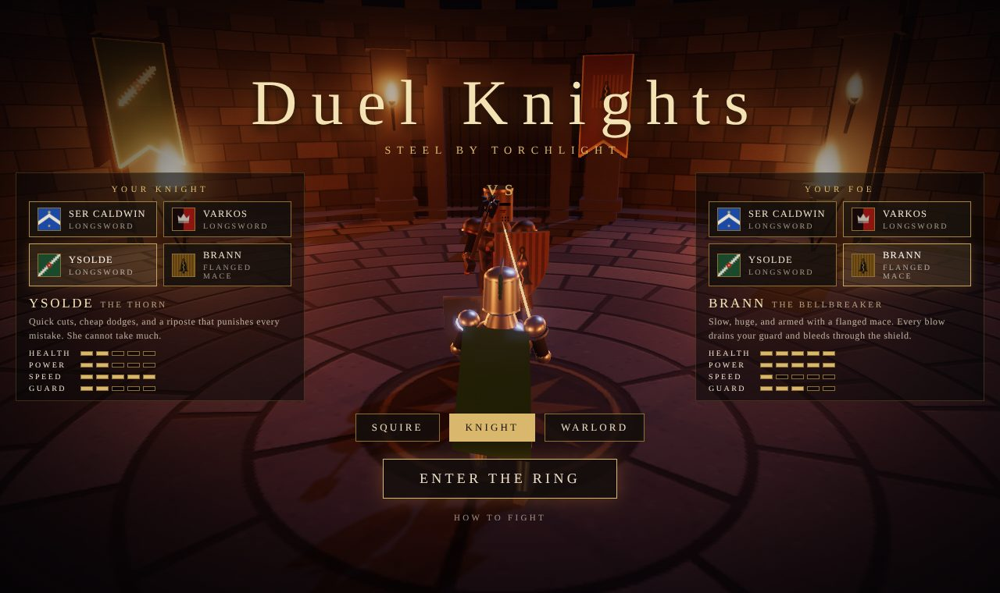
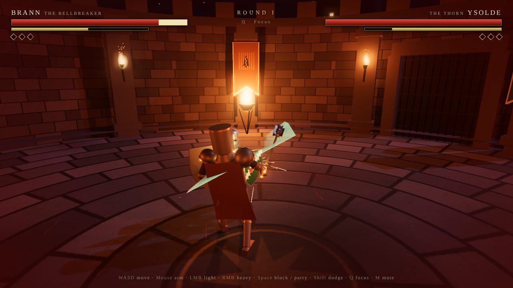

# Duel Knights

A torch-lit 3D sword duel in the browser. Pick a knight, pick a foe, first to three rounds.
Everything (the knights, the arena, the sound) is built in code from primitives with
[Three.js](https://threejs.org/). There are no asset files.



## Play

The game is split into ES modules, and browsers won't load those from a file on disk.
Serve the folder instead:

```bash
python -m http.server 8000
```

Then open <http://localhost:8000>. Use a desktop browser with a keyboard and mouse. Three.js
loads from a CDN, so you need to be online the first time.

| Input | Action |
|:--|:--|
| W A S D | Move. You face where the mouse aims |
| Left click | Light attack. Swords chain three cuts, the mace two swings |
| Right click | Heavy overhead. Tap Space during the windup to feint |
| Space | Block. Raise it just before a blow lands to parry |
| Shift | Dodge toward your movement keys |
| Q | Focus (lock facing onto your foe) |
| P / M | Pause / mute |

## The knights

| Knight | Weapon | Style |
|:--|:--|:--|
| **Ser Caldwin**, the Azure | Longsword | The baseline. Three-cut combo, even stats |
| **Varkos**, the Ashen King | Longsword | Bigger, sturdier guard, harder overheads, a step slower |
| **Ysolde**, the Thorn | Longsword | Fast cuts, cheap dodges, big ripostes; low health |
| **Brann**, the Bellbreaker | Flanged mace | Slow and huge. Blows drain guards and bleed through shields |



## Project layout

```
index.html          page, styles, menus and HUD markup
src/main.js         game flow, input, knight select, camera, HUD, main loop
src/characters.js   the roster: look, weapon, stats, AI style, select-screen ratings
src/weapons.js      weapon models and hit shapes (longsword, mace)
src/moves.js        poses and attack data (timings, damage, stamina, keyframes)
src/fighter.js      the fighter state machine, IK animation, hit volumes
src/combat.js       hits, blocks, parries, clashes
src/brain.js        the AI (difficulty settings + per-character style)
src/knight.js       procedural knight model (helms, armour, shield)
src/arena.js        the arena, fire and embers
src/ragdoll.js      Verlet ragdoll for knockouts
src/fx.js           sparks, dust, hit-stop, slow motion, camera shake
src/audio.js        synthesised sound
src/textures.js     procedural textures and heraldry
tests/sim.mjs       AI-vs-AI smoke test and balance table
```

### Adding a knight

Add an entry to `ROSTER` in `src/characters.js`. Anything you leave out of `stats` uses the
defaults in `BASE_STATS` (`src/fighter.js`). A new coat of arms goes in `EMBLEMS`
(`src/textures.js`). Then run the balance check.

## Balance check

```bash
node tests/sim.mjs 20
```

This runs 20 AI-vs-AI matches for every pairing in headless Chromium (needs
[Playwright](https://playwright.dev/)). It prints each knight's win rate against the others,
and fails if the page throws an error or a match never ends. AI-vs-AI results are a sanity
check, not a substitute for playing. At 20 matches per pairing, expect about ±15% noise.

## Origin

Duel Knights grew out of **Ashen Crown**, the Claude Fable 5.2 entry in
[medieval-duel-bench](https://github.com/bitofastickler/medieval-duel-bench). The first commit
here is that file unchanged. The benchmark copy stays as it was.
